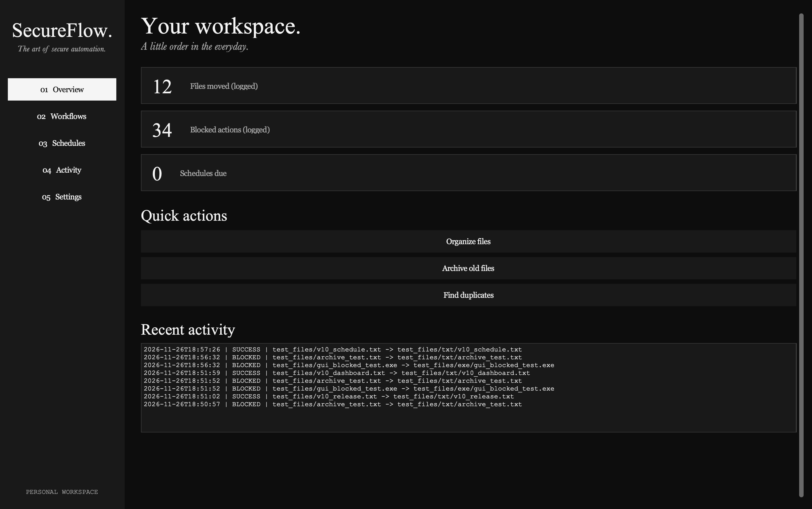

# SecureFlow — Secure Personal Automation

SecureFlow is a Python-based desktop application for automating everyday file management tasks with a focus on cybersecurity and user control.

I built SecureFlow to explore how personal automation can be implemented safely without giving an application unrestricted access to the filesystem. File operations are validated, previewed, and explicitly approved before execution.

**Version:** 1.0  
**Status:** Complete



## Features

- Organize files into folders based on their extensions.
- Archive old files using configurable age thresholds.
- Detect duplicate files using SHA-256 hashing without modifying them.
- Preview and approve file operations before execution.
- Configure workflow schedules and track processing history.
- Monitor successful, blocked, failed, and cancelled operations.
- Manage workflows through a graphical dashboard or command-line interface.

## Security

The security layer is separated from the automation logic. Workflows generate proposed actions, while dedicated security components determine whether those actions can be executed.

Security controls include:

- Authorized workspace restrictions
- Path traversal and symbolic-link checks
- File extension and size validation
- Destination overwrite prevention
- Permission revalidation before execution
- Explicit user approval
- Audit log sanitization
- Partial-move failure reporting
- Atomic scheduling history replacement

## Dashboard

The graphical interface is built with CustomTkinter and features a monochromatic design.

| Section | Function |
|---------|----------|
| Overview | Workspace activity and quick actions |
| Workflows | File operation previews and approval |
| Schedules | Workflow intervals and processing history |
| Activity | Searchable audit logs and status filtering |
| Settings | Security configuration and workspace restrictions |

Additional screenshots: [Workflows](docs/screenshots/workflows.png) · [Schedules](docs/screenshots/schedules.png) · [Activity](docs/screenshots/activity.png) · [Settings](docs/screenshots/settings.png)

## Tech Stack

- Python
- CustomTkinter and Tkinter
- SHA-256 hashing
- JSON
- unittest
- Git and GitHub

## Getting Started

Requires Python 3 with Tkinter support.

Developed and tested on macOS using Python 3.14.6, Tk 9.0.3, and CustomTkinter 6.0.0.

### Installation

```bash
git clone https://github.com/mahikazi/secure-personal-automation.git
cd secure-personal-automation

python3 -m venv .venv
source .venv/bin/activate

./.venv/bin/python -m pip install -r requirements.txt

mkdir -p test_files
```

### Run the Application

Graphical dashboard:

```bash
./.venv/bin/python -m dashboard.app
```

Command-line interface:

```bash
./.venv/bin/python main.py
```

Add sample files to the `test_files` directory to try the automation workflows.

## Configuration

Security policies are defined in `config/settings.json`.

```json
{
  "allowed_folder": "test_files",
  "allowed_extensions": [".txt", ".pdf", ".jpg", ".png", ".csv"],
  "max_file_size_mb": 20
}
```

Workflow intervals are configured in `config/schedules.json`.

Scheduled workflows are manually triggered and remain subject to the same security checks and approval requirements.

## Project Structure

```text
secure-personal-automation/
├── config/          # Security and scheduling configuration
├── dashboard/       # Graphical interface
├── scheduler/       # Workflow scheduling and history
├── security/        # Permissions, execution, approval, and logging
├── workflows/       # File automation logic
├── tests/           # Automated tests
├── docs/            # Dashboard screenshots
├── main.py          # Command-line interface
├── requirements.txt
└── README.md
```

## Testing

The final release includes 83 passing automated tests covering:

- Permission validation and security restrictions
- File execution and error handling
- Workflow previews and user approval
- Scheduling and runtime integrity
- Dashboard functionality
- Duplicate detection
- Component integration

Run the complete test suite:

```bash
./.venv/bin/python -m unittest discover -s tests -v
```

End-to-end manual testing was also completed through both the command-line interface and graphical dashboard.

## Limitations

SecureFlow is a personal cybersecurity project rather than a production-grade security tool.

File moves are not fully atomic, filesystem race conditions remain possible, and audit logs are not tamper-resistant. Cross-filesystem moves are not supported. Scheduling requires manual interaction, and compatibility outside macOS has not been fully tested.

## What I Learned

Building SecureFlow gave me hands-on experience with secure software design, filesystem security, input validation, defensive programming, automated testing, and graphical application development.

The project grew from a basic file organizer into a desktop automation platform with configurable security policies, workflow approval, scheduling, and activity monitoring.