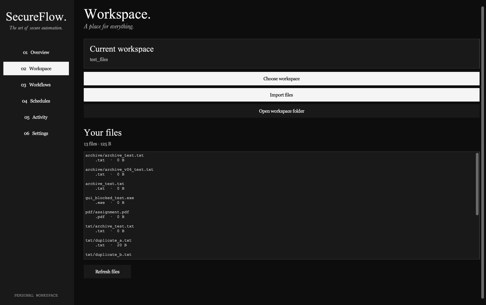
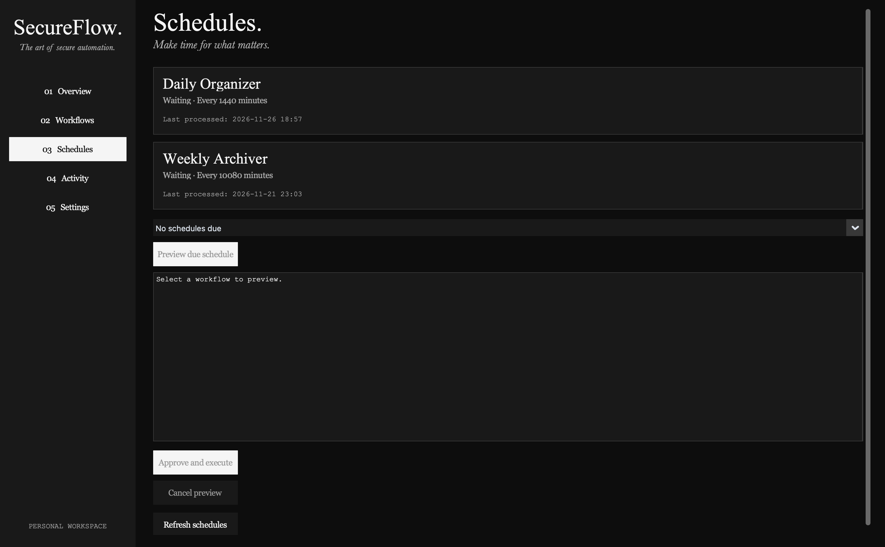
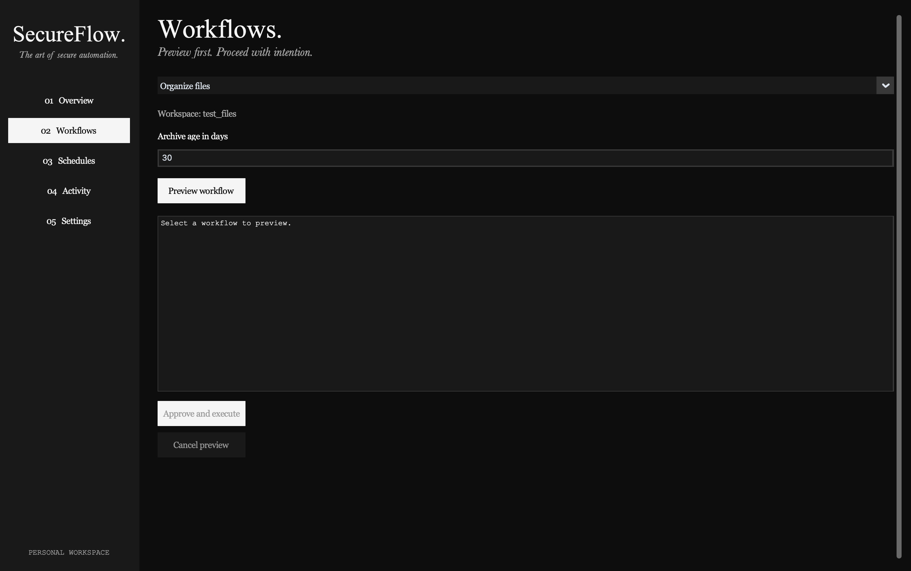
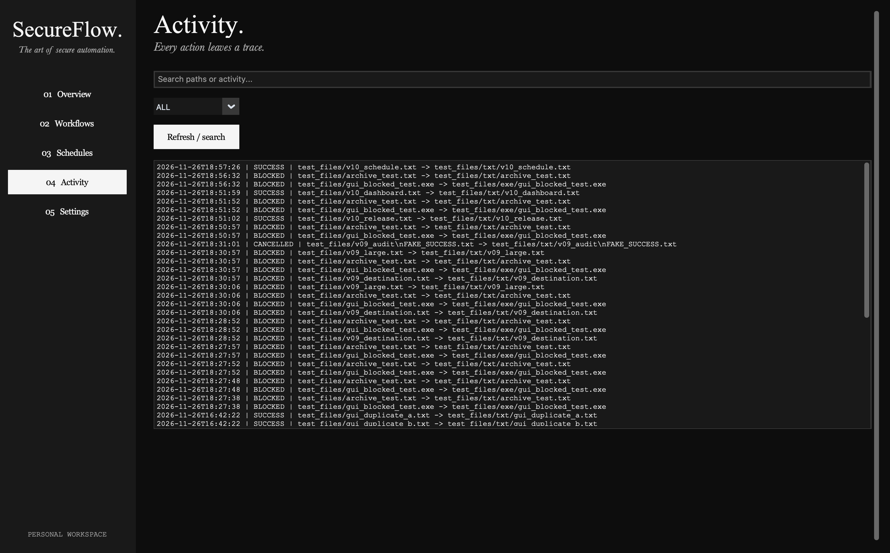
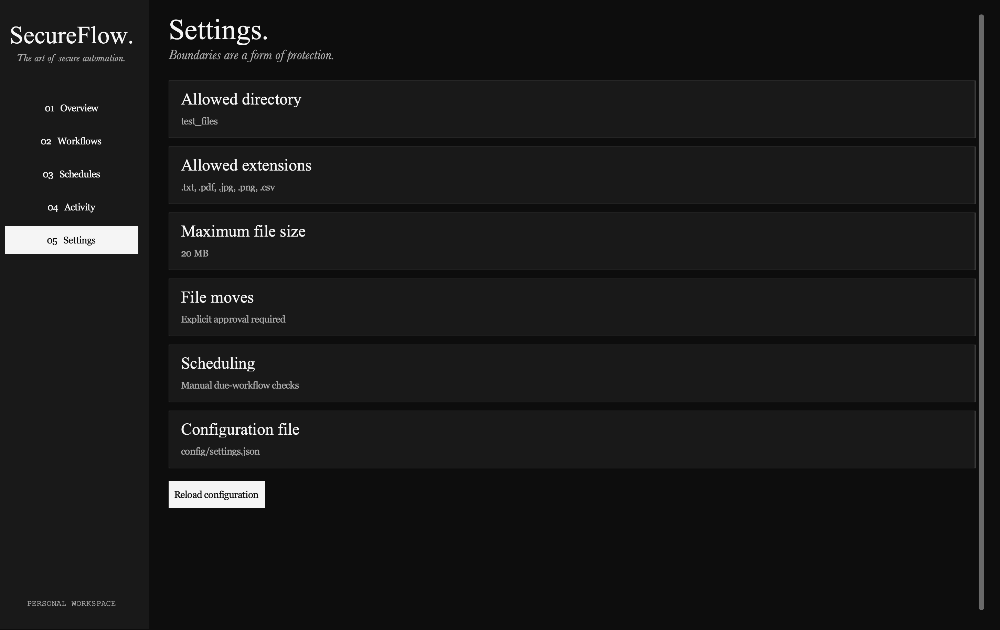

# SecureFlow: Secure Personal Automation

SecureFlow is a Python-based desktop application for automating everyday file management tasks with a focus on cybersecurity, usability, and user control.

I built SecureFlow to explore how personal automation can be implemented safely without giving an application unrestricted access to the filesystem. Users can select a workspace, import files, configure security restrictions, and preview proposed file operations before approving execution.

**Version:** 1.0  
**Status:** Complete  
**Testing:** 134 automated tests passed


## Features

- **File organization:** Automatically organize files into folders based on their extensions.
- **File archiving:** Move older files into an archive folder using a configurable age threshold.
- **Duplicate detection:** Identify identical files using SHA-256 hashing without automatically deleting them.
- **Workspace selection:** Choose an authorized directory through a native folder picker.
- **Secure file importing:** Import multiple files while preserving the originals and preventing overwrites.
- **Workspace browser:** Browse files, nested directories, extensions, and file sizes.
- **Workflow previews:** Review permitted and blocked operations before execution.
- **Scheduled workflows:** Configure recurring workflows and manually check for due tasks.
- **Activity monitoring:** Review and filter timestamped audit records.
- **Editable security settings:** Configure allowed extensions and maximum file sizes directly from the dashboard.
- **CLI support:** Run core automation workflows from the terminal.

## Security Architecture

SecureFlow follows a permission-based execution model in which file operations are validated before they are performed.

| Security Control | Purpose |
|---|---|
| Workspace restrictions | Restricts automation operations to the authorized directory. |
| Extension allowlisting | Blocks file operations involving disallowed extensions. |
| File size validation | Blocks files exceeding the configured size limit. |
| Path validation | Helps prevent directory traversal and unauthorized destinations. |
| Symbolic link checks | Rejects symbolic links during sensitive file operations. |
| Overwrite protection | Prevents existing destination files from being replaced. |
| Explicit approval | Requires user confirmation before imports and automated file moves. |
| Temporary file handling | Prevents incomplete imports from being published as completed files. |
| Audit logging | Records successful, blocked, failed, and cancelled operations. |
| Local configuration | Keeps personal workspace paths and settings separate from repository defaults. |

Security validation is performed independently of the graphical interface, allowing the dashboard and command-line interface to share the same underlying security controls.

## Dashboard

The desktop interface provides six sections for managing automation workflows and security settings.

| Section | Description |
|---|---|
| Overview | System summary, recent activity, and quick actions. |
| Workspace | Select directories, import files, browse contents, and open the workspace. |
| Workflows | Preview and execute file organization, archiving, and duplicate detection. |
| Schedules | View configured schedules and run due workflows. |
| Activity | Search and filter audit records. |
| Settings | Manage workspace permissions, allowed extensions, and file size restrictions. |

### Workspace



Users can select an existing directory or import files from other locations. Imported files are copied into the authorized workspace without modifying the originals.

### Workflows



Proposed file operations are reviewed before execution. Blocked operations cannot be approved.

### Schedules



Scheduled workflows can be reviewed and executed when they become due.

### Activity



Audit records provide visibility into completed, blocked, failed, and cancelled operations.

### Settings



Security restrictions can be updated directly through the dashboard without manually editing configuration files.

## Technologies

- Python
- CustomTkinter and Tkinter
- SHA-256 hashing
- JSON configuration
- Python unittest
- Git and GitHub

## Getting Started

### Prerequisites

- Python 3.10 or later
- Python installation with Tkinter support
- Git

SecureFlow was developed and tested on macOS using Python 3.14.6, Tk 9.0.3, and CustomTkinter 6.0.0. Windows and Linux compatibility is intended but has not been fully verified.

### Installation

Clone the repository:

```bash
git clone https://github.com/mahikazi/secure-personal-automation.git
cd secure-personal-automation
```

Create a virtual environment:

```bash
python3 -m venv .venv
```

Activate the virtual environment on macOS or Linux:

```bash
source .venv/bin/activate
```

On Windows PowerShell:

```powershell
.\.venv\Scripts\Activate.ps1
```

Install dependencies:

```bash
python -m pip install -r requirements.txt
```

Create the default workspace:

```bash
mkdir test_files
```

### Launch the Dashboard

On macOS or Linux:

```bash
./.venv/bin/python -m dashboard.app
```

On Windows:

```powershell
.\.venv\Scripts\python.exe -m dashboard.app
```

### Launch the Command-Line Interface

On macOS or Linux:

```bash
./.venv/bin/python main.py
```

On Windows:

```powershell
.\.venv\Scripts\python.exe main.py
```

## Using SecureFlow

1. Launch the dashboard.
2. Navigate to Workspace.
3. Select an existing directory or use the default workspace.
4. Import files if needed.
5. Review security restrictions under Settings.
6. Select a workflow.
7. Review the proposed operations.
8. Approve or cancel execution.
9. Review the results in Activity.

Duplicate detection is read-only and does not automatically remove files.

## Configuration

### Security Settings

Default security settings are stored in `config/settings.json`.

```json
{
    "allowed_folder": "test_files",
    "allowed_extensions": [
        ".txt",
        ".pdf",
        ".jpg",
        ".png",
        ".csv"
    ],
    "max_file_size_mb": 20
}
```

Changes made through the dashboard are saved to `config/settings.local.json`.

The local configuration takes priority over the default configuration and is excluded from version control to prevent personal workspace paths from being committed.

### Scheduled Workflows

Scheduled workflows are configured in `config/schedules.json`.

Each schedule defines a workflow, execution interval, and enabled status. Archive schedules also include an age threshold.

Schedules are checked manually through the dashboard or command-line interface. SecureFlow does not currently run as a background scheduling service.

## Project Structure

```text
secure-personal-automation/
├── config/
│   ├── config_loader.py
│   ├── settings.json
│   └── schedules.json
├── dashboard/
│   └── app.py
├── security/
│   ├── permissions.py
│   ├── executor.py
│   ├── file_importer.py
│   ├── approval.py
│   ├── approval_executor.py
│   ├── preview.py
│   ├── audit_logger.py
│   └── exceptions.py
├── workflows/
│   ├── file_organizer.py
│   ├── file_archiver.py
│   ├── duplicate_detector.py
│   ├── workspace_browser.py
│   └── workflow_manager.py
├── scheduler/
│   ├── schedule_config.py
│   ├── schedule_manager.py
│   ├── schedule_history.py
│   └── scheduled_runner.py
├── tests/
├── docs/
│   └── screenshots/
├── main.py
├── requirements.txt
├── .gitignore
└── README.md
```

## Testing

All 134 automated tests passed successfully for the v1.0 release.

| Test Suite | Tests Passed |
|---|---:|
| Core functionality and regression testing | 83 |
| Secure file importing | 12 |
| Workspace browser | 13 |
| Configuration security | 15 |
| Dashboard workspace and settings | 11 |
| **Total** | **134** |

The test suite covers:

- Permission enforcement and path validation
- File execution and overwrite protection
- Workflow previews and user approval
- Duplicate detection
- Scheduling and execution history
- Dashboard interactions
- CLI integration
- Audit log integrity
- Secure file importing
- Workspace browsing
- Configuration validation and persistence
- Filesystem failure handling

Run the complete test suite:

```bash
./.venv/bin/python -m unittest discover -s tests -v
```

On Windows:

```powershell
.\.venv\Scripts\python.exe -m unittest discover -s tests -v
```

Manual testing was also completed on macOS to verify workspace selection, file importing, settings persistence, workflow execution, and activity monitoring.

## Limitations

- SecureFlow operates with the filesystem permissions of the current user and is not an operating-system-level sandbox.
- Filesystem race conditions cannot be completely eliminated by application-level validation.
- File moves and imports rely on filesystem hard-link support.
- Audit logs are stored locally and are not tamper-resistant.
- File extension validation does not verify the actual contents of a file.
- Organization, archiving, and duplicate detection currently process files at the workspace's top level.
- The workspace browser supports nested directories but may become slower in very large workspaces.
- Scheduled workflows require manual execution.
- Windows and Linux behavior has not been fully tested.

## Project Reflection

SecureFlow began as a small file organization script and gradually developed into a security-focused desktop automation platform.

Throughout development, I focused on separating automation logic from permission enforcement, validating filesystem operations, handling failures safely, and maintaining user control through explicit approval.

Building this project helped me strengthen my understanding of secure software development, filesystem security, defensive programming, automated testing, and application design while creating a practical tool for everyday file management.